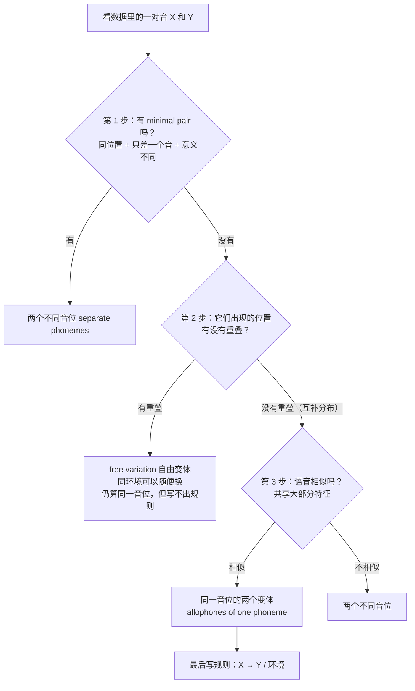

# AHGC7315 小抄｜音系分析不混乱版

> **用法**：考前 10 分钟只看这一份。整份都是大白话 + 图，不堆术语。
> 看着还乱的地方，直接回来问我，我换个说法再讲一遍。

---

## 0. 一句话总纲（先把这个装进脑子）

把"音位"想成**身份**，把"音位变体"想成**同一个人的不同打扮**。

- pin 的 /p/ 在词首时"盛装"（送气 [pʰ]），spin 的 /p/ 在 s 后面"便装"（不送气 [p]）。
- 打扮不同，但**是同一个人**，因为换成便装以后，词还是 pin，没变成别的词。

所以判断"是不是同一音位"，**只看一件事：这两个音出现的位置会不会重叠。**

更严谨的表述应该是：

> **判断是否为不同音位，要看这两个音能否出现在相同的位置（位置重叠），并且替换后是否改变词义（构成最小对立对）。**
> 
> - 如果位置重叠 + 改变词义 = **不同音位**。
>     
> - 如果位置重叠 + 不改变词义 = **同一音位的自由变体**。
>     
> - 如果位置不重叠（互补分布） = **同一音位的条件变体**。
>

---

## 1. 什么叫"环境"？（一张图看懂）

```
   前面是什么音          这个音本身           后面是什么音
  ┌───────────┐      ┌──────────┐      ┌──────────────┐
  │  V 或 C   │  →   │   [ x ]  │  →   │ V / C / 没有音 │
  └───────────┘      └──────────┘      └──────────────┘
                          ↑
              我们问的是它"夹在中间"的位置
              ___ 就是"这个音所在的位置"那个下划线
```

| 要看哪里 | 写法 | 你手上的例子 |
|---|---|---|
| **前面**是什么音 | `V ___` | 德语题：[ç] 出现在**前元音之后** |
| **后面**是什么音 | `___ V` | 韩语题：[r] 出现在**元音之前** |
| **是不是边界** | `___ #`（词尾）、`# ___`（词首） | 韩语题：[l] 出现在**词尾** |

> 别忘了：**"词尾"也是一个环境**（后面是"词的边界"），不是"没有环境"。

---

## 2. 三步走流程图（照着走，脑子的线就不会打结）



**三步口诀**：**先找最小对 → 再查位置重叠 → 最后看像不像。**

---

## 3. 最快的做法：画一张"位置打勾表"

不要凭感觉，**把每个音出现的位置打勾**，答案自己会跳出来。

### 例 1：韩语的数据

| 出现的环境 | 元音前 `___V` | 辅音前 `___C` | 词尾 `___#` |
|---|---|---|---|
| **[r]** | ✔ | ✗ | ✗ |
| **[l]** | ✗ | ✔ | ✔ |

**一眼看出**：两行没有任何一列同时是 ✔ → **不重叠 = 互补分布** → 再查"像不像" → 都是流音，像 → **同一音位**。
规则：**/l/ → [r] / ___ V**（在元音前读 [r]，其余位置保持 [l]）。

### 例 2：德语的数据

| 出现的环境 | 前元音后 `V[+front] ___` | 非前元音后 `V[-front] ___` |
|---|---|---|
| **[ç]** | ✔ | ✗ |
| **[x]** | ✗ | ✔ |

同一种打法：不重叠 → 互补分布 → 都是清擦音，像 → **同一音位 /x/**，规则 **/x/ → [ç] / V[+front] ___**。

### 如果某一列同时有两个 ✔ 呢？

说明"位置重叠"了，去看有没有 minimal pair：

- 有（两词只差这一个音、意思不同）→ **两个音位**。
- 没有，而且可以随便换 → **free variation（自由变体）**。

---

## 4. 判断结果速查表（看到哪一行就写哪一句）

| 你观察到 | 结论 | 英文答题句 |
|---|---|---|
| 同位置只差一个音，意思变了 | **两个不同音位** | They occur in **minimal pairs** such as X vs. Y, so they are **allophones of two different phonemes**. |
| 位置从不同时出现 + 长得像 | **同一音位** | They are **allophones of the same phoneme**: they occur in **complementary distribution** and are **phonetically similar**. |
| 位置不重叠但长得不像 | **两个不同音位** | They are in complementary distribution but are **not phonetically similar**, so they belong to different phonemes. |
| 同一位置可以随便换、意思不变 | **自由变体** | They are in **free variation**. |

---

## 5. 课程里出现过的所有例子，对号入座

| 音对 | 有 minimal pair？ | 位置重叠？ | 像不像？ | 结论 |
|---|---|---|---|---|
| [p] vs [pʰ]（英） | 无 | 不重叠 | 像 | **同一音位 /p/** |
| [h] vs [ŋ]（英） | 无 | 不重叠 | **不像** | **两个音位** |
| [s] vs [z]（英） | **有**（sip / zip） | 重叠 | — | **两个音位** |
| [r] vs [l]（韩） | 无 | 不重叠 | 像 | **同一音位 /l/** |
| [x] vs [ç]（德） | 无 | 不重叠 | 像 | **同一音位 /x/** |
| [k] vs [x]（希腊） | **有**（kano / xano） | 重叠 | — | **两个音位** |
| [k] vs [c]（希腊） | 无 | 不重叠 | 像 | **同一音位 /k/** |

> ⚠️ 希腊语那张表里**两种结论同时存在**：k 和 x 是两个音位，k 和 c 是同一音位。
> **所以永远一对一对地判断**，不要整张表给一个结论。

---

## 6. 答案怎么写（三段式，背下来）

**第 1 段：给结论**
> [x] and [ç] are **allophones of the same phoneme**.

**第 2 段：给理由（能写几句写几句）**
> They **do not occur in any minimal pairs**. They are in **complementary distribution**: [x] occurs only after non-front vowels, and [ç] only after front vowels. They are also **phonetically similar** (both are voiceless fricatives).

**第 3 段：写规则（题目问到就必须写）**
> The underlying phoneme is **/x/**, with the rule: **/x/ → [ç] / V[+front] ___**.

**如果结论是两个音位**，第 2 段换成：
> They occur in **minimal pairs** such as *sip* vs. *zip*; substituting one sound for the other **changes the meaning**.

### 底层形式（"默认那个音"）怎么选？

- 选更常见、更默认的那一个。跨语言的常态是：**软腭音在前元音前变硬腭音**，所以德语题选 **/x/**，变体是 [ç]；韩语题选 **/l/**，变体是 [r]。
- 写法方向：**"变出来的那个"放右边** → `/x/ → [ç] / 环境`。

---

## 7. 三个必须避开的坑

1. **只凭互补分布就答"同一音位"** → 错。[h] 与 [ŋ] 也互补分布，但一个声门擦音、一个软腭鼻音 → 两个音位。
2. **凭"听起来像不像"判断** → 错。[p] 与 [pʰ] 物理上明显不同，但它们仍是**同一音位**。
3. **只要两个词不一样就说不同音位** → 错。必须"**只差一个音 + 位置相同 + 意义不同**"三条同时满足。（只差重音不算；同音词如 cereal / serial 也不算。）

---

## 8. 做完题 30 秒自查（每道题念一遍）

- [ ] 我先找 minimal pair 了吗？
- [ ] 我是画了"位置打勾表"，还是凭感觉？
- [ ] 我检查"语音相似性"了吗？
- [ ] 我写规则了吗？格式是 `X → Y / 环境`？
- [ ] 底层形式我选的是哪个？理由说了吗？

---

## 9. 顺带：其他部分的一行小抄

| 主题 | 一行记住 |
|---|---|
| 元音图 | 12 个单元音：前 i ɪ e ɛ æ ／中 ə ʌ ／后 u ʊ o ɔ ɑ |
| tense / lax | i–ɪ（bead–bid）、e–ɛ（bait–bet）、u–ʊ（food–foot）、o–ɔ（code–caught） |
| 圆唇 / 双元音 | 圆唇只有 **u ʊ o ɔ**；双元音只有 **aɪ aʊ ɔɪ** |
| 辅音 VPM | 清浊 + 部位 + 方式；鼻音与近音可省 voicing |
| 送气 | 词首清塞音送气 [pʰ tʰ kʰ]；/s/ 后同音节不送气 |
| 部位顺序 | 双唇→唇齿→齿→齿龈→后齿龈→硬腭→软腭→声门（8 个） |
| 音节结构 | **nucleus 必须有**；rime = nucleus + coda |
| 形态 | free / bound；**派生改词义或词性，屈折只加语法** |
| 8 个屈折语素 | -s, -ed, -ing, -en, -s, -'s, -er, -est（全是后缀） |
| 形态分析 | 找词干 → 找重复出现的语素 → 定前缀 / 后缀 |
