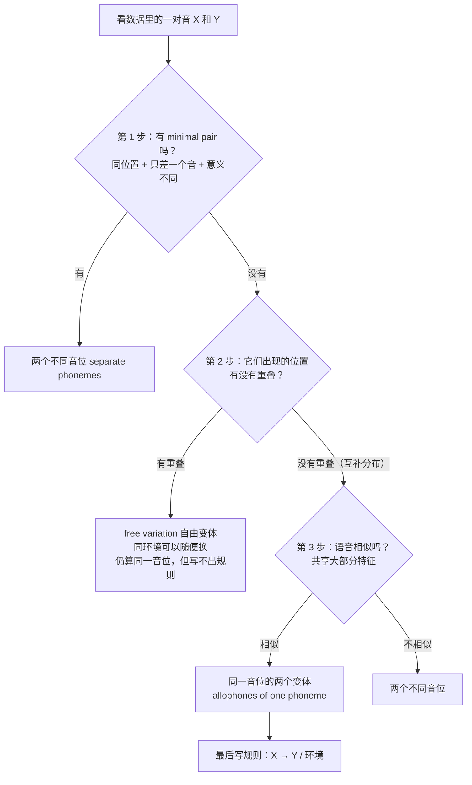

# AHGC7315 小抄｜音系分析不混乱版

> **用法**：考前 10 分钟只看这一份。整份都是大白话 + 图，不堆术语。
> 看着还乱的地方，直接回来问我，我换个说法再讲一遍。

---

## 0. 一句话总纲（先把这个装进脑子）

把"音位"想成**身份**，把"音位变体"想成**同一个人的不同打扮**。

- pin 的 /p/ 在词首时"盛装"（送气 [pʰ]），spin 的 /p/ 在 s 后面"便装"（不送气 [p]）。
- 打扮不同，但**是同一个人**，因为换成便装以后，词还是 pin，没变成别的词。

所以判断"是不是同一音位"，**只看一件事：这两个音出现的位置会不会重叠。**

---

## 1. 什么叫"环境"？（一张图看懂）

```
   前面是什么音          这个音本身           后面是什么音
  ┌───────────┐      ┌──────────┐      ┌──────────────┐
  │  V 或 C   │  →   │   [ x ]  │  →   │ V / C / 没有音 │
  └───────────┘      └──────────┘      └──────────────┘
                          ↑
              我们问的是它"夹在中间"的位置
              ___ 就是"这个音所在的位置"那个下划线
```

| 要看哪里 | 写法 | 你手上的例子 |
|---|---|---|
| **前面**是什么音 | `V ___` | 德语题：[ç] 出现在**前元音之后** |
| **后面**是什么音 | `___ V` | 韩语题：[r] 出现在**元音之前** |
| **是不是边界** | `___ #`（词尾）、`# ___`（词首） | 韩语题：[l] 出现在**词尾** |

> 别忘了：**"词尾"也是一个环境**（后面是"词的边界"），不是"没有环境"。

---

## 2. 三步走流程图（照着走，脑子的线就不会打结）



**三步口诀**：**先找最小对 → 再查位置重叠 → 最后看像不像。**

---

## 3. 最快的做法：画一张"位置打勾表"

不要凭感觉，**把每个音出现的位置打勾**，答案自己会跳出来。

### 例 1：韩语的数据

| 出现的环境 | 元音前 `___V` | 辅音前 `___C` | 词尾 `___#` |
|---|---|---|---|
| **[r]** | ✔ | ✗ | ✗ |
| **[l]** | ✗ | ✔ | ✔ |

**一眼看出**：两行没有任何一列同时是 ✔ → **不重叠 = 互补分布** → 再查"像不像" → 都是流音，像 → **同一音位**。
规则：**/l/ → [r] / ___ V**（在元音前读 [r]，其余位置保持 [l]）。

### 例 2：德语的数据

| 出现的环境 | 前元音后 `V[+front] ___` | 非前元音后 `V[-front] ___` |
|---|---|---|
| **[ç]** | ✔ | ✗ |
| **[x]** | ✗ | ✔ |

同一种打法：不重叠 → 互补分布 → 都是清擦音，像 → **同一音位 /x/**，规则 **/x/ → [ç] / V[+front] ___**。

> ⚠️ **这里是最容易踩的坑：环境写得太粗。**
> 如果两边都只写 `V ___`（"元音之后"），两个音的环境看起来**一模一样**，就会误判成"不互补了"。
> 正确做法是**把元音再分一层**：`V[+front] ___`（前元音后）对比 `V[-front] ___`（非前元音后）——这样才分得开。
> 口诀：**环境要细到"刚好能把这两个音分开"，多一个特征都不要写。**

> **老师板书里那个大括号 `V ___` 是什么意思？**
> 那是"**共同点**"的简写：两列的音都出现在**元音之后**。但"元音"还要再分：
> 左边 [x] 后面的元音全是**非前元音**（a: ɔ u: o: ʊ），右边 [ç] 后面的元音全是**前元音**（i ɪ e: ɛ）。
> 所以真正的区分点是 **[+front] / [-front]** → 完整环境是 `V[+front] ___`，规则才是 /x/ → [ç] / V[+front] ___。
>
> **通用技巧**：环境要写到"**能区分两组**"的那个程度。只写 `V ___` 太粗（两列都符合，等于没区分）；加上 [+front] 才够细。

### 如果某一列同时有两个 ✔ 呢？

说明"位置重叠"了，去看有没有 minimal pair：

- 有（两词只差这一个音、意思不同）→ **两个音位**。
- 没有，而且可以随便换 → **free variation（自由变体）**。

---

## 4. 判断结果速查表（看到哪一行就写哪一句）

| 你观察到 | 结论 | 英文答题句 |
|---|---|---|
| 同位置只差一个音，意思变了 | **两个不同音位** | They occur in **minimal pairs** such as X vs. Y, so they are **allophones of two different phonemes**. |
| 位置从不同时出现 + 长得像 | **同一音位** | They are **allophones of the same phoneme**: they occur in **complementary distribution** and are **phonetically similar**. |
| 位置不重叠但长得不像 | **两个不同音位** | They are in complementary distribution but are **not phonetically similar**, so they belong to different phonemes. |
| 同一位置可以随便换、意思不变 | **自由变体** | They are in **free variation**. |

---

## 5. 课程里出现过的所有例子，对号入座

| 音对 | 有 minimal pair？ | 位置重叠？ | 像不像？ | 结论 |
|---|---|---|---|---|
| [p] vs [pʰ]（英） | 无 | 不重叠 | 像 | **同一音位 /p/** |
| [h] vs [ŋ]（英） | 无 | 不重叠 | **不像** | **两个音位** |
| [s] vs [z]（英） | **有**（sip / zip） | 重叠 | — | **两个音位** |
| [r] vs [l]（韩） | 无 | 不重叠 | 像 | **同一音位 /l/** |
| [x] vs [ç]（德） | 无 | 不重叠 | 像 | **同一音位 /x/** |
| [k] vs [x]（希腊） | **有**（kano / xano） | 重叠 | — | **两个音位** |
| [k] vs [c]（希腊） | 无 | 不重叠 | 像 | **同一音位 /k/** |

> ⚠️ 希腊语那张表里**两种结论同时存在**：k 和 x 是两个音位，k 和 c 是同一音位。
> **所以永远一对一对地判断**，不要整张表给一个结论。

---

## 6. 答案怎么写（三段式，背下来）

**第 1 段：给结论**
> [x] and [ç] are **allophones of the same phoneme**.

**第 2 段：给理由（能写几句写几句）**
> They **do not occur in any minimal pairs**. They are in **complementary distribution**: [x] occurs only after non-front vowels, and [ç] only after front vowels. They are also **phonetically similar** (both are voiceless fricatives).

**第 3 段：写规则（题目问到就必须写）**
> The underlying phoneme is **/x/**, with the rule: **/x/ → [ç] / V[+front] ___**.

**如果结论是两个音位**，第 2 段换成：
> They occur in **minimal pairs** such as *sip* vs. *zip*; substituting one sound for the other **changes the meaning**.

### 底层形式（"默认那个音"）怎么选？

- 选更常见、更默认的那一个。跨语言的常态是：**软腭音在前元音前变硬腭音**，所以德语题选 **/x/**，变体是 [ç]；韩语题选 **/l/**，变体是 [r]。
- 写法方向：**"变出来的那个"放右边** → `/x/ → [ç] / 环境`。

---

## 7. 三个必须避开的坑

1. **只凭互补分布就答"同一音位"** → 错。[h] 与 [ŋ] 也互补分布，但一个声门擦音、一个软腭鼻音 → 两个音位。
2. **凭"听起来像不像"判断** → 错。[p] 与 [pʰ] 物理上明显不同，但它们仍是**同一音位**。
3. **只要两个词不一样就说不同音位** → 错。必须"**只差一个音 + 位置相同 + 意义不同**"三条同时满足。（只差重音不算；同音词如 cereal / serial 也不算。）

---

## 8. 做完题 30 秒自查（每道题念一遍）

- [ ] 我先找 minimal pair 了吗？
- [ ] 我是画了"位置打勾表"，还是凭感觉？
- [ ] 我检查"语音相似性"了吗？
- [ ] 我写规则了吗？格式是 `X → Y / 环境`？
- [ ] 底层形式我选的是哪个？理由说了吗？

---

## 9. 形态分析四步法（"外语数据"题通用，配意大利语例题）

遇到"给一门外语的数据 + 英文翻译，问词根/词缀/怎么说"的题，**永远按这四步走**，不要凭感觉猜。

### 第 0 步：先看"数据形状"，10 秒选对方法（不用猜题型）

你不需要事先知道老师出的是哪种题——**数一数"一个外语词对应几个英文词"**就知道了：

| 数据形状 | 长什么样 | 类型 | 用什么方法 |
|---|---|---|---|
| 外语词数 **≈** 英文词数 | *un uomo robusto* ＝ *a robust man*（**3 : 3**） | **分词型** | **对齐表**：一词对一词（注意词序可能正好相反） |
| 外语词数 **<** 英文词数（一个词 = 一小句） | *nokali* ＝ *my house*（**1 : 2**）；*sachaaha* ＝ *I am tall*（**1 : 3**） | **粘着型** | **切段 / 三格表**：前缀 + 词干 + 后缀 |

**切几格也能从数据里数出来**（看"同一个词干的几种形式差在哪里"）：

| 差别出现在哪 | 说明前面/后面有几格 |
|---|---|
| 只在词首变（sa- / chi- / hoo- / 没有） | **前面一格**（人称前缀） |
| 只在词尾变（-tok / 没有） | **后面一格**（时态后缀） |
| 两头都在变 | **三格**：前缀 + 词干 + 后缀 |

> **所以起手式永远是同一套**，不用提前分类：
> ① 抄成两列表（外语 / 英文）→ ② 圈出重复出现的形式（重复的 = 语素）→ ③ 如果外语词数和英文对不上，立刻切段填三格表。

### 第 1 步：对齐（先把外语词和英文词一个一个对上）

| Italian | 怎么拆 | English | 对上的关系 |
|---|---|---|---|
| un uomo | un + uomo | a man | un = a；uomo = man |
| un uomo robusto | un + uomo + robust + o | a robust man | robust = robust |
| un uomo robustissimo | un + uomo + robust + **issim** + o | a very robust man | **issim = very** |
| una donna robusta | una + donna + robust + a | a robust woman | una = a；donna = woman |
| un vino rosso | un + vino + ross + o | a red wine | vino = wine；ross = red |
| una faccia | una + faccia | a face | faccia = face |
| un vento secco | un + vento + secc + o | a dry wind | vento = wind；secc = dry |

### 第 2 步：找重复（重复出现的部分 = 同一个语素）

- man 永远配 **uomo**，wine 永远配 **vino**，face 配 **faccia**，wind 配 **vento** → 这些是**词干**。
- 和 "robust" 有关的三行都含 **robust-** → **词根 = robust**。
- 只有"very"那两行多出 **-issim-** → **-issim- = very**。

### 第 3 步：相减验证（用"只差一点"的两行对比）

- *robustissimo*（very robust）↔ *robusto*（robust）：差别只有 **-issim-**。
- *robustissima*（very robust woman）↔ *robusta*：同样只差 **-issim-**。

→ 两次都指向同一个结论：**"very" = -issim-**，位置在词干和词尾之间。

### 第 4 步：照公式生成（c 小题就是这一步）

公式：**名词（自带性别）+ 形容词词干 +（要 very 就加 issim）+ 一致词尾**

| 要说的 | 怎么拼 | 答案 |
|---|---|---|
| a robust wine | vino（阳性）+ robust + o | **un vino robusto** |
| a very red face | faccia（阴性）+ ross + issim + a | **una faccia rossissima** |
| a very dry wine | vino（阳性）+ secc + issim + o | **un vino seccissimo** |

### 怎么确定"哪个词对哪个词"？用这四级证据（从硬到软）

| 优先级 | 证据 | 意大利语这题里的用法 |
|---|---|---|
| **① 最硬：重复共现** | 同一个外语词在多行里都对应同一个英文词 | un 出现 5 次、una 出现 3 次，英文全都是 a → un / una = a；uomo 三行都配 man → uomo = man；robust- 三行都配 robust |
| **② 次硬：结构位置** | 用"已经确定的那几行"读出这门外语的**语序**，再套到没见过的行 | 从 "un uomo robusto = a robust man" 读出：意大利语是 **冠词 + 名词 + 形容词**；于是 "un vino rosso" 里第 2 个词 vino 是名词、第 3 个 rosso 是形容词 |
| **③ 交叉验证：形态一致** | 词尾 -o / -a 的一致关系 | vino、vento、uomo 都是 -o（阳性），faccia 是 -a（阴性）→ 说明"形容词跟在名词后并跟它一致"这个判断是对的 |
| **④ 最软：同源词 / 常识** | 词本身长得像英语或拉丁词 | vino ~ wine / 法语 vin；vento ~ vent（风）；rosso（红）、secco（dry） |

> ★ **关键心法**：**别用英语的语序去套外语**，要用"已经确定的那几行"读出**外语自己的语序**。
> 语序在同一门语言内部是**一致的**——所以你可以"用已知推未知"：先定 un = a、uomo = man、robusto = robust，语序自然就出来了，再拿这个语序去解读 vino rosso、vento secco。

> **回代检查（收尾必做）**：对应表定完之后，把**每一行**用你的表重新读一遍；只要有一行读不通，说明前面某处判错了，回去改。

### 通用技巧（这六条背下来，所有语言都通用）

1. **先对齐，再切分**——不要一上来就切语素。
2. **重复出现的部分 = 语素**（在两个以上条目里都出现，就一定是同一个语素）。
3. **只差一点点的一对词，差的就是那个语素**（*robusto* ↔ *robustissimo*）。
4. **词尾在变（-o / -a）= 一致关系**（阳性 / 阴性），先记下来，答生成题要用。
5. **只用数据里的证据**，不要凭"我猜这门语言是这样"。
6. **生成题按数据里的顺序拼**：前缀在前、后缀在后；该加冠词就加冠词。

> 同一套四步也能做 kali / pelo（找词干 → 找 no-/mo-/i- 和 -mes → 组装）与 Chickasaw（找词干 → 找 sa-/chi-/hoo- 和 -tok）。

### 三格法：前缀 + 词干 + 后缀（Chickasaw 例题，专治"对不上号"）

Chickasaw 这题不像意大利语那样"一个词对一个词"，它**一个词里塞了三格信息**：**谁 + 状态 + 时间**。所以做法不是逐词翻译，而是**把每个词切成三格、然后竖着比**。

**第 1 步：先把英文里的信息拆成三格。**

| 英文 | 谁 | 状态 | 时间 |
|---|---|---|---|
| I am tall | I | tall | 现在 |
| you were tired | you | tired | 过去 |
| they were hungry | they | hungry | 过去 |
| he/she is tall | he/she | tall | 现在 |

**第 2 步：把每个 Chickasaw 词按位置填进三格表（填不出就留空）。**

| Chickasaw | 前格：谁 | 中格：状态 | 后格：时间 | English |
|---|---|---|---|---|
| **sa**chaaha | **sa** | chaaha | — | I am tall |
| chaaha | **∅（无前缀）** | chaaha | — | he/she is tall |
| **chi**chaaha | **chi** | chaaha | — | you are tall |
| **hoo**chaaha | **hoo** | chaaha | — | they are tall |
| **sa**tikahbi | **sa** | tikahbi | — | I am tired |
| **chi**tikahbi**tok** | **chi** | tikahbi | **tok** | you were tired |
| **chi**chchokwa | **chi** | chokwa | — | you are cold |
| hopoba**tok** | **∅** | hopoba | **tok** | he was hungry |
| **hoo**hopoba**tok** | **hoo** | hopoba | **tok** | they were hungry |
| **sa**hopoba | **sa** | hopoba | — | I am hungry |

**第 3 步：竖着看每一列**——重复出现的部分就是语素，答案自己跳出来：

| 格子 | 语素 | 证据 |
|---|---|---|
| 前格："I" | **sa-** | 三行以 sa- 开头，英文都是 I |
| 前格："you" | **chi-** | 三行以 chi- 开头，英文都是 you |
| 前格："they" | **hoo-** | hoochaaha / hoohopobatok，英文都是 they |
| 前格："he/she" | **∅（零形式）** | chaaha、hopobatok 前面什么都没有，英文却是 he/she |
| 中格：状态 | **chaaha / tikahbi / chokwa / hopoba** | 就是"tall / tired / cold / hungry"的词干 |
| 后格：过去时 | **-tok** | hopobatok、chitikahbitok、hoohopobatok 的"was / were" |

**第 4 步：拼句子（c 小题）。** 公式 = **谁 + 词干 +（过去就加 -tok）**，现在时后格留空：

| 要说的 | 怎么拼 | 答案 |
|---|---|---|
| You are old（词干 sipokni） | chi + sipokni | **chisipokni** |
| He was old | ∅ + sipokni + tok | **sipoknitok** |
| They are old | hoo + sipokni | **hoosipokni** |

> ⚠️ **唯一一个"看起来对不上"的词**：**chichchokwa**（you are cold）。它其实是 **chi + chokwa**，中间那个多出来的 ch 是两个音撞在一起的**同化**结果（chi 的元音被后面的 ch 影响）。**不要被这一个词打乱**，按"chi- = you、chokwa = cold"读就通了。

> ⚠️ **别忘了零形式**：第三人称 he/she **不加任何前缀**（chaaha、hopobatok）。答题时要写 "he/she = **∅ (zero morpheme)**"，这一个空很容易丢分。

---

## 10. 顺带：其他部分的一行小抄

| 主题 | 一行记住 |
|---|---|
| 元音图 | 12 个单元音：前 i ɪ e ɛ æ ／中 ə ʌ ／后 u ʊ o ɔ ɑ |
| tense / lax | i–ɪ（bead–bid）、e–ɛ（bait–bet）、u–ʊ（food–foot）、o–ɔ（code–caught） |
| 圆唇 / 双元音 | 圆唇只有 **u ʊ o ɔ**；双元音只有 **aɪ aʊ ɔɪ** |
| 辅音 VPM | 清浊 + 部位 + 方式；鼻音与近音可省 voicing |
| 送气 | 词首清塞音送气 [pʰ tʰ kʰ]；/s/ 后同音节不送气 |
| 部位顺序 | 双唇→唇齿→齿→齿龈→后齿龈→硬腭→软腭→声门（8 个） |
| 音节结构 | **nucleus 必须有**；rime = nucleus + coda |
| 形态 | free / bound；**派生改词义或词性，屈折只加语法** |
| 8 个屈折语素 | -s, -ed, -ing, -en, -s, -'s, -er, -est（全是后缀） |
| 形态分析 | 找词干 → 找重复出现的语素 → 定前缀 / 后缀 |
